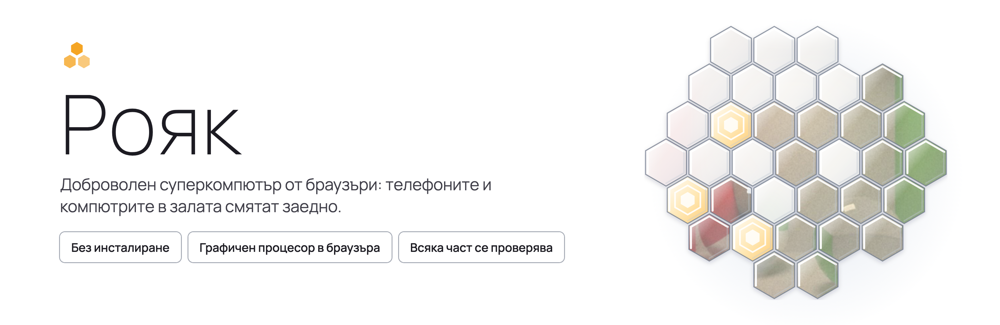
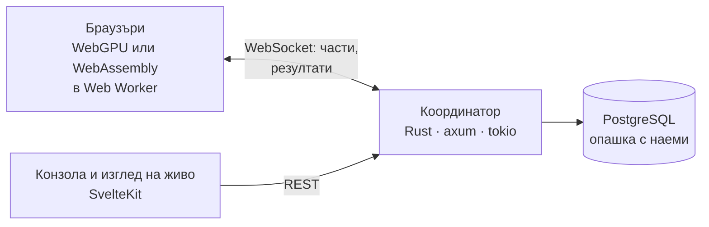

<div align="center">

<picture>
  <source media="(prefers-color-scheme: dark)" srcset="docs/assets/banner-dark.png">
  
</picture>

**[Опитай на живо](https://swarmrelay.duckdns.org)**  ·  [Ръководство](https://swarmrelay.duckdns.org/guide)  ·  [REST API](https://swarmrelay.duckdns.org/docs/api)  ·  [Документация](%D0%BF%D1%80%D0%B8%D0%BB%D0%BE%D0%B6%D0%B5%D0%BD%D0%B8%D0%B51.pdf)  ·  [Презентация](%D0%A0%D0%BE%D1%8F%D0%BA-%D0%BF%D1%80%D0%B5%D0%B7%D0%B5%D0%BD%D1%82%D0%B0%D1%86%D0%B8%D1%8F.pdf)  ·  [Диплянка](%D0%A0%D0%BE%D1%8F%D0%BA-%D0%B4%D0%B8%D0%BF%D0%BB%D1%8F%D0%BD%D0%BA%D0%B0.pdf)

[](.github/workflows/ci.yml)


</div>

---

## Накратко

Рояк събира училищните компютри, лаптопите и телефоните в един изчислителен ресурс. Устройството
се включва с отваряне на страница или със сканиране на QR код, **без да се инсталира нищо**, и смята
част от голяма задача на графичния си процесор (WebGPU) или, ако няма такъв, на процесора (WebAssembly).
Координаторът проверява всеки резултат, защото всеки може да се включи и да опита да излъже.

- **Без инсталиране и без права на администратор.** BOINC и Folding@home изискват и двете, а в училище това е невъзможно.
- **Всяко училище има своя мрежа:** роли, одобряване на устройствата, пауза, работно време, свои задачи.
- **Резултатите са проверени.** Две устройства смятат всяка част, контролни части с известен отговор хващат измамниците.

<table>
<tr>
<td width="220" align="center"></td>
<td>

### Включи се

1. Насочи камерата към кода или отвори [swarmrelay.duckdns.org](https://swarmrelay.duckdns.org).
2. Натисни „Включи се“. Спираш с един бутон, когато поискаш.
3. Виж клетката си в живия изглед на роя.

<sub>По подразбиране устройството работи със 75 % мощност и спира при скрита страница; в Chrome и Edge и при батерия под 30 %.</sub>

</td>
</tr>
</table>

## Какво смята

| | |
|---|---|
| **Седмично разписание** | Заместник-директорът внася учебния план от таблица; устройствата на училището търсят разписание паралелно, а координаторът преценява всяко. Ръчна редакция с предварително показана цена на промяната, печат по класове и учители. |
| **Обучение на невронни мрежи** | Всяко устройство обучава една настройка, побитово еднакво навсякъде; класацията се попълва на живо. |
| **Изобразяване и Монте Карло** | Картината се попълва плочка по плочка; числото π с проверен генератор на случайни числа. |
| **Езикови модели** | Малък модел (SmolLM2) отговаря на файл с въпроси; всяко устройство с видеокарта изпълнява целия модел в браузъра. |
| **Свои програми** | Код на WebAssembly без достъп до мрежа, файлове и часовник; проверява се при качване. |

## Как работи



- **Наеми.** Всяка част се дава за ограничено време; ако устройството замлъкне, тя се връща в опашката. Опашката е в PostgreSQL (`FOR UPDATE SKIP LOCKED`), така че две устройства не получават едно и също копие.
- **Детерминизъм.** Случайните числа зависят само от брояча, а сметките са целочислени: π, невронните мрежи и разписанията дават побитово еднакъв резултат на всяко устройство и се сравняват точно. Изобразяването се сравнява с допуск.
- **Един източник на истината.** Ядрата на Rust служат за проверка в координатора, за варианта на WebAssembly в браузъра и за тестовете; ядрата на WGSL се сверяват с тях по споделени вектори.
- **Само известен код.** Браузърът изпълнява само ядро с хеш, който съвпада с подадения от координатора.
- **REST API по OpenAPI 3.1.** Всичко, което прави конзолата, става и през API с ключ на мрежата. Описанието се
  генерира от самия код ([/docs/api](https://swarmrelay.duckdns.org/docs/api)), а тест проверява, че всеки маршрут е описан.
- **Функции, които се включват и изключват без внедряване.** Администраторът изключва задачите с ИИ, теста на
  устойчивостта или програмите в общата мрежа; сървърът отказва изключеното, а конзолата го скрива.

Подробна карта, начертана по кода: [architecture.html](docs/design/architecture.html).

## Измерено

Всяко число идва от [docs/measurements.md](docs/measurements.md), където са методът и условията.

| Какво | Резултат |
|---|---|
| 13 компютъра в кабинета (Intel i3 от 2011–2012 г., без WebGPU) | Картина 1920×1080 за около 70 s и 107 милиарда проби за π за 43 s; побитово еднакви със сървъра |
| Телефон Nothing Phone (1) | 800 милиона проби за π в секунда, еднакво през 10,6 минути, без прегряване |
| MacBook Pro, Apple M1 Max | 7,4 милиарда проби за π в секунда в WebKit; еднакъв резултат до последния бит в Chrome, Edge, WebKit и Firefox |
| 1 000 симулирани устройства | Около 1 000 резултата в секунда, нито едно отпаднало |
| Измамник; двама в сговор | Хванат за 3,1–3,4 s; сговорът за около 70 s, приетите му части са преизчислени |
| Цена на проверката | 1,20–1,26 изчисления на част вместо 2,0 |
| Езиков модел, телефон срещу лаптоп | 30 от 30 отговора съвпадат (9 до последния токен) |
| 8 еднакви виртуални устройства (по едно ядро) | π 7,8 пъти по-бързо от едно устройство (98 %), изображение 7,4 пъти (92 %) |

Още не са измерени: кривата на ускорението върху компютрите в кабинета, iPhone и данни на истинско училище.

## Стартиране

Нужни са Docker, Rust (версията е в `rust-toolchain.toml`), Node с pnpm и [`just`](https://github.com/casey/just).

```bash
docker compose up -d      # PostgreSQL и Redis
just coordinator          # координаторът на порт 7700
just web                  # сайтът на порт 7701
just sim 4                # четири симулирани устройства
```

`just check` пуска всичко, което проверява CI; `just e2e` пуска браузърните тестове. Разгръщане: `just deploy`
(виж [demo-day.md](docs/competition/demo-day.md) за публичния адрес и резервните планове).

## Хранилището

```text
crates/       Rust: coordinator, kernels (+ WebAssembly), protocol, programs, timetable, sim-worker
web/          SvelteKit: страница за доброволеца, конзола, изглед на живо, Web Workers
templates/    ядра на WGSL, тестови вектори, каталог на моделите
sdk/ examples/  Rust SDK и пример за собствена програма (WebAssembly)
deploy/       Docker, Caddy, Prometheus, Tailscale
scripts/      помощни скриптове: модели, тестови профили, материали
docs/         спецификации, измервания, тестове, дизайн и материалите за състезанието
```

## Тестове

- **Rust:** 299 теста, много срещу истинска PostgreSQL: опашка при едновременен достъп, свойствени тестове на разписанията, пълни сценарии със симулирани устройства и измамници.
- **Браузър:** 147 модулни теста (Vitest) и тестове от край до край (Playwright) в Chromium с и без WebGPU, Firefox и WebKit.
- **CI:** GitHub Actions пуска всичко при всяко качване, а всяка нощ проверява публичния адрес така, както го ползва журито (страниците, API и входа с тестовите профили).
- **Данни:** базата се архивира всяка нощ и се пази 14 дни; `just backup-check` възстановява последния архив и го сравнява с живата база. Списък: [automated-suites.md](docs/tests/automated-suites.md); изпитването в кабинета: [docs/tests](docs/tests/).

## Материали за журито

| | |
|---|---|
| [Документация](%D0%BF%D1%80%D0%B8%D0%BB%D0%BE%D0%B6%D0%B5%D0%BD%D0%B8%D0%B51.pdf) | описанието на проекта по Приложение 1 на регламента, пет страници, с тестови профили за всяка роля |
| [Презентация](%D0%A0%D0%BE%D1%8F%D0%BA-%D0%BF%D1%80%D0%B5%D0%B7%D0%B5%D0%BD%D1%82%D0%B0%D1%86%D0%B8%D1%8F.pdf) | защитата, 17 слайда; [сценарий](docs/competition/presentation/%D1%81%D1%86%D0%B5%D0%BD%D0%B0%D1%80%D0%B8%D0%B9.md) по минути |
| [Диплянка](%D0%A0%D0%BE%D1%8F%D0%BA-%D0%B4%D0%B8%D0%BF%D0%BB%D1%8F%D0%BD%D0%BA%D0%B0.pdf) | A4, сгъване на три, за печат (виж [PRINT.md](docs/competition/brochure/PRINT.md)) |
| [Ръководство](https://swarmrelay.duckdns.org/guide) · [REST API](https://swarmrelay.duckdns.org/docs/api) | как се използва за всяка роля; описание на API с възможност за проба |
| [Регистрация](docs/competition/registration.md) · [Пътна карта](docs/roadmap.md) · [Спецификации](docs/specs/) | анотацията към формуляра, какво следва, всяка функция със своя спецификация |

## Следва

- Модел, който отговаря на български, и модел за реч („препиши записа на урока“).
- Разписания: две смени, своя стая на класа, измерване върху данни на истинско училище и върху XHSTT.
- Подписани шаблони, размер на частите според устройството, вход с акаунт на Google или Microsoft, режим „киоск“ за кабинета.

## Екип и лиценз

Страцимир Стефанов Андонов, 11 б клас, ППМГ „Гео Милев“, Стара Загора; ръководител Светла Антонова Парапанова.
Направление „Разпределени приложения“ на Националния есенен турнир по информационни технологии „Джон Атанасов“.

Свободен софтуер под [GPL-3.0](LICENSE).
